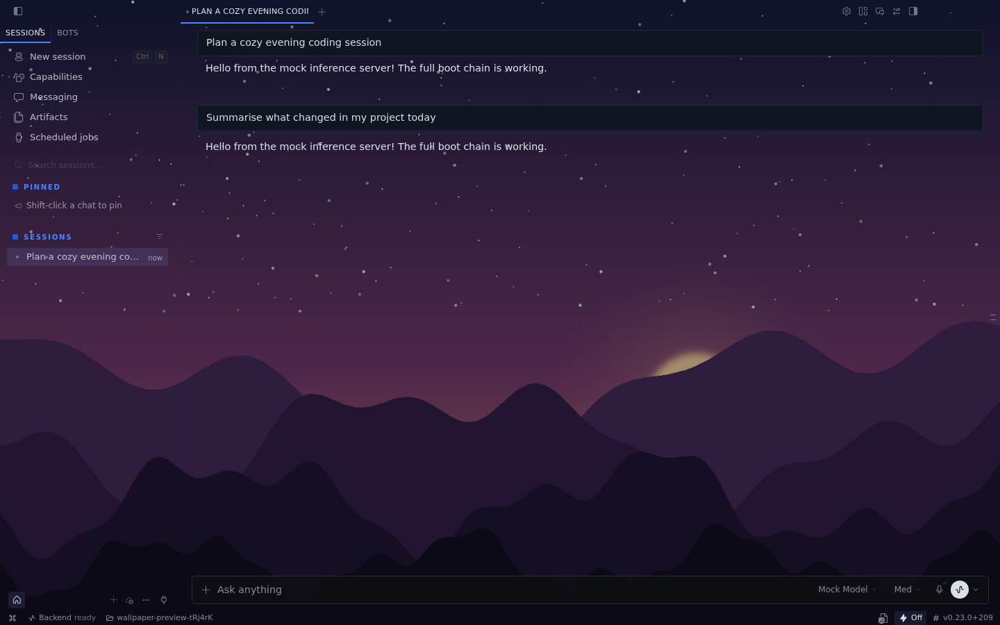
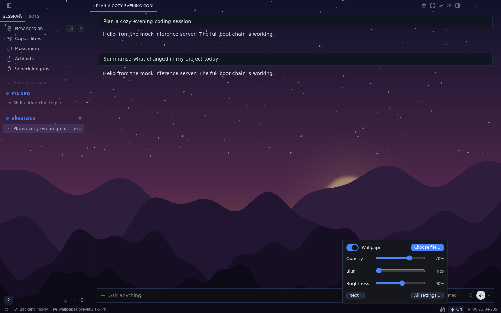
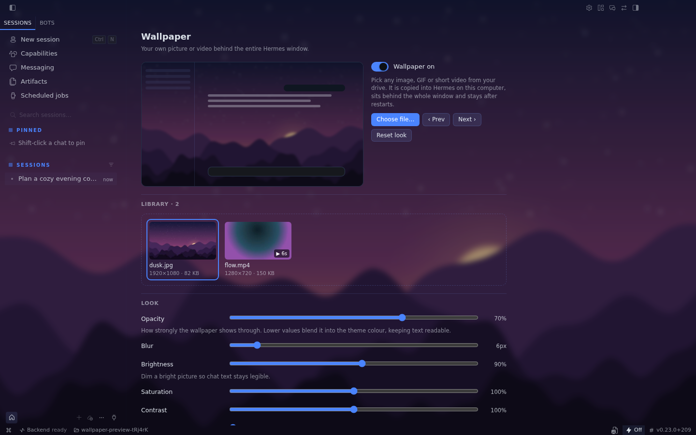

# Wallpaper for Hermes Desktop

Put any image, GIF or short video from your drive behind the **whole** Hermes Desktop
window — sidebar, chat, title bar and status bar — and tune how it looks.



## Features

- **Pick a file the normal way.** *Choose file…* opens your OS file dialog; you can
  also drop files onto the library on the settings page. Images (PNG, JPEG, WebP,
  AVIF, GIF, SVG, …) and videos (MP4/H.264, WebM, Ogg) are supported.
- **Behind everything.** The wallpaper sits under the entire app. Menus, dialogs and
  other raised surfaces stay solid so they remain readable.
- **Look:** opacity, blur, brightness, saturation, contrast and vignette.
- **Layout:** fill, fit, stretch, center or tile; anchor (center/top/bottom/left/right);
  zoom; mirror.
- **Video:** playback speed, pause while Hermes is minimized, pause while another app
  is focused, and a still frame when the OS asks for reduced motion. Videos are always
  muted.
- **Library & slideshow:** keep several backgrounds, switch with a click or *Prev/Next*,
  or rotate them every 1/5/15/60 minutes (optionally shuffled).
- **Live preview** in the settings, so you can tune it while the settings card covers
  the real background. Double-click a slider to reset it.

| Quick controls in the status bar | Full settings |
|---|---|
|  |  |

## Install

```bash
hermes plugins install hermes-wallpaper
```

Then turn it on in the Desktop app (**Settings → Plugins**, or the install dialog does it
for you). It is a Desktop-only plugin: there is nothing to enable on the agent side.

Requires Hermes **0.22.1** or newer.

## Where to find it

- **Status bar** (bottom right): the image icon opens quick controls — on/off,
  *Choose file…*, opacity, blur, brightness, *All settings…*. Right-click the status bar
  to hide the icon if you don't want it.
- **Command palette** (⌘K / Ctrl+K): *Wallpaper: Choose image or video…*,
  *Wallpaper: Turn on/off*, *Wallpaper: Next*, *Wallpaper: Settings*.
- **Settings → Plugins → Wallpaper**, the bottom of **Settings → Appearance**, and the
  `/wallpaper` page.

## Privacy and what the plugin touches

- **No network, no backend, no agent tools.** The plugin is a single
  `desktop/plugin.js` that only imports `@hermes/plugin-sdk` and `react`.
- **Your files stay on your computer.** A picked file is copied into the plugin's own
  IndexedDB database (`hermes-wallpaper`) inside the Desktop app's local profile, so it
  survives restarts even if you move or delete the original. Remove a file from the
  library (✕ on its card) to delete the copy. Large videos take the same amount of disk
  space; the plugin warns above 400 MB.
- **Settings** are stored with the SDK's `ctx.storage` (keys under
  `hermes.plugin.hermes-wallpaper.`).
- **How it paints behind the UI.** While a wallpaper is showing, the plugin adds its own
  fixed element (`#hermes-wallpaper-layer`, `z-index: -1`) and one `<style>` tag, and
  sets its own attribute `data-hermes-wallpaper` on `<html>`. Under that attribute the
  style applies the same transparent-surface rules Desktop's built-in glass mode uses:
  the surface CSS variables (`--ui-chat-surface-background`, `--ui-sidebar-surface-background`,
  `--ui-editor-surface-background`) become transparent, the two full-window shell painters
  (`[data-contrib-shell]`, `[data-slot='sidebar-wrapper']`) drop their fill, and surfaces
  Desktop marks `data-glass-opaque` / `data-glass-raised` stay filled. Nothing else in the
  app is queried, clicked, hidden or rewritten. Turning the wallpaper off, or disabling the
  plugin, removes the attribute, the element and the style tag.

## Known limits

- Video support is whatever Chromium in Electron plays: MP4 (H.264) and WebM work;
  HEVC/ProRes `.mov` files (e.g. many iPhone recordings) usually do not. Such files are
  rejected with a message instead of leaving a broken background.
- Files live in the Desktop app on *that* computer. Using Hermes Desktop on a second
  machine means picking the wallpaper there as well.
- Desktop's own glass/translucency mode and this plugin both make the surfaces
  transparent; with both on, the wallpaper replaces the see-through effect.

## Development

- `desktop/plugin.js` is plain ESM loaded uncompiled — no build step.
- Validate like catalog CI does: `hermes plugins validate . --install-deps`.
- End-to-end test (isolated Desktop with a mock LLM, real file chooser, image + MP4 +
  WebM, reload persistence, off switch): `HERMES_AGENT_DIR=/path/to/hermes-agent tests/run-e2e.sh`
  (needs `xvfb-run` and `ffmpeg`; prints `E2E PASS`).

## License

MIT — see [LICENSE](LICENSE).
